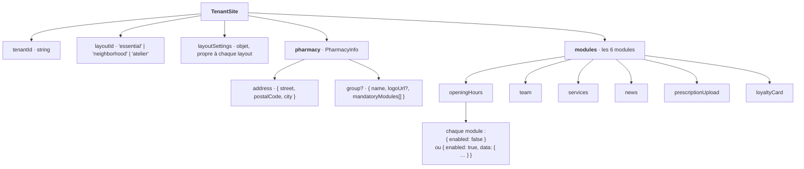

# Les données que l'API doit envoyer

Le serveur des sites trouve la pharmacie à partir du nom de domaine, demande ses données à l'API, les
valide avec `TenantSiteSchema`, puis appelle `createTenantSitePage`. Ce document décrit ces données, et
la requête que le site renvoie à l'API quand un visiteur envoie une ordonnance.

La source de vérité est le code : `engine/schema/src/`. Ici, c'est la version lisible.

## Vue d'ensemble



## `TenantSite`

| Champ | Type | Obligatoire | Description |
|---|---|---|---|
| `tenantId` | `string` non vide | oui | Identifiant de la pharmacie, ex. `pharmacie-dupont`. Le moteur ne s'en sert pas : l'envoi d'une ordonnance prend le tenant de la passerelle |
| `layoutId` | `string` non vide | oui | Le layout à utiliser. Un identifiant inconnu provoque une erreur qui liste les layouts disponibles |
| `layoutSettings` | objet | non (défaut `{}`) | Les réglages du layout, validés par le schéma du layout choisi (voir plus bas) |
| `pharmacy` | `PharmacyInfo` | oui | Les informations générales de la pharmacie |
| `modules` | objet | oui | Les 6 modules, chacun activé ou non |

**Règle métier :** chaque module listé dans `pharmacy.group.mandatoryModules` doit avoir
`enabled: true`. Sinon le tenant est refusé :

```
× Le module « loyaltyCard » est imposé par le groupement « Alliance Santé Proximité » : il ne peut pas être désactivé.
```

## `pharmacy` (PharmacyInfo)

Commun à tous les layouts. Le layout le reçoit en entier, en lecture seule, et affiche ce qu'il veut.

| Champ | Type | Obligatoire | Règle |
|---|---|---|---|
| `name` | `string` | oui | Non vide |
| `address.street` | `string` | oui | Non vide |
| `address.postalCode` | `string` | oui | 5 chiffres |
| `address.city` | `string` | oui | Non vide |
| `phone` | `string` | oui | Non vide, affiché tel quel (ex. `04 78 42 15 30`) |
| `email` | `string` | non | Adresse e-mail valide |
| `logoUrl` | `string` | non | URL d'une image |
| `group` | objet | non | Absent si la pharmacie n'appartient à aucun groupement |
| `group.name` | `string` | oui si `group` | Non vide |
| `group.logoUrl` | `string` | non | Sans logo, les layouts affichent le nom |
| `group.mandatoryModules` | liste de noms de modules | non (défaut `[]`) | Les modules que le groupement impose à ses pharmacies |

Noms de modules valides : `openingHours`, `team`, `services`, `news`, `prescriptionUpload`, `loyaltyCard`.

## `modules`

Les 6 clés sont **toutes obligatoires**. Chaque module est soit désactivé, soit activé avec ses données :

```json
{ "enabled": false }
{ "enabled": true, "data": { … } }
```

### `openingHours`

| Champ | Type | Règle |
|---|---|---|
| `weeklySchedule` | objet avec les 7 jours | `monday`, `tuesday`, `wednesday`, `thursday`, `friday`, `saturday`, `sunday` sont tous obligatoires |
| `weeklySchedule.<jour>` | liste de `{ opensAt, closesAt }` | Heures au format `HH:MM`. Une liste vide signifie « fermé » |
| `onDutyPeriods` | liste de `{ startsAt, endsAt }` | Facultatif (défaut `[]`). Horodatages ISO **avec fuseau** : `2026-10-21T19:00:00+02:00` ou `…Z` |

À partir de `onDutyPeriods`, le moteur affiche « En garde actuellement, jusqu'à … » ou « En garde ce
soir, à partir de … ». Le message « composez le 3237 » est ajouté par le moteur : il ne vient pas de l'API.

### `team`

| Champ | Type | Règle |
|---|---|---|
| `members` | liste | |
| `members[].fullName` | `string` | Non vide |
| `members[].role` | `string` | Non vide |
| `members[].photoUrl` | `string` | Facultatif. Sans photo, les layouts affichent les initiales |

### `services`

| Champ | Type | Règle |
|---|---|---|
| `services` | liste | |
| `services[].title` | `string` | Non vide |
| `services[].description` | `string` | Non vide |
| `services[].iconName` | `'syringe' \| 'test-tube' \| 'heart-pulse' \| 'pill' \| 'leaf'` | Facultatif |

### `news`

| Champ | Type | Règle |
|---|---|---|
| `articles` | liste | Dans n'importe quel ordre : le moteur les trie du plus récent au plus ancien |
| `articles[].title` | `string` | Non vide |
| `articles[].summary` | `string` | Non vide |
| `articles[].publishedAt` | `string` | Date ISO `YYYY-MM-DD` |
| `articles[].imageUrl` | `string` | Facultatif |

### `prescriptionUpload`

| Champ | Type | Règle |
|---|---|---|
| `introduction` | `string` | Facultatif. Sans texte, chaque layout affiche le sien |

### `loyaltyCard`

| Champ | Type | Règle |
|---|---|---|
| `text` | `string` | Obligatoire, non vide. Seul affiché quand il n'y a pas d'image |
| `url` | `string` | Obligatoire, URL absolue de la page d'inscription |
| `imageUrl` | `string` | Facultatif. Le visuel de la carte |

## `layoutSettings`, selon le layout

Chaque réglage a une valeur par défaut : l'API peut n'envoyer que ceux qui changent, ou `{}`.

| Layout | Réglage | Type | Défaut |
|---|---|---|---|
| `essential` | aucun | | |
| `neighborhood` | `slogan` | `string` | « Votre pharmacie de quartier, toujours à votre écoute. » |
| `neighborhood` | `heroImageUrl` | `string` | aucune image : une illustration la remplace |
| `neighborhood` | `showOnDutyBanner` | `boolean` | `true` |
| `neighborhood` | `primaryColor` (thème) | `#rrggbb` | `'#1f6b45'` |
| `neighborhood` | `accentColor` (thème) | `#rrggbb` | `'#f2b84b'` |
| `neighborhood` | `headingFont` (thème) | `'fraunces' \| 'spaceGrotesk'` | `'fraunces'` |
| `atelier` | `accentTone` (thème) | `'terracotta' \| 'sage' \| 'saffron'` | `'terracotta'` |
| `atelier` | `displayFont` (thème) | `'instrumentSerif' \| 'fraunces'` | `'instrumentSerif'` |
| `atelier` | `editorialHeadline` | `string` | « Prendre soin, simplement. » |

Un réglage d'un mauvais type est refusé au rendu : « Réglages invalides pour le layout … ».

## Exemple complet

```json
{
  "tenantId": "pharmacie-dupont",
  "layoutId": "neighborhood",
  "layoutSettings": {
    "slogan": "Au cœur du quartier depuis 1987.",
    "heroImageUrl": "https://cdn.exemple.fr/pharmacie-dupont/facade.jpg"
  },
  "pharmacy": {
    "name": "Pharmacie Dupont",
    "address": { "street": "12 rue de la République", "postalCode": "69002", "city": "Lyon" },
    "phone": "04 78 42 15 30",
    "email": "contact@pharmacie-dupont.fr",
    "logoUrl": "https://cdn.exemple.fr/pharmacie-dupont/logo.svg",
    "group": {
      "name": "Réseau Officinal",
      "logoUrl": "https://cdn.exemple.fr/groupements/reseau-officinal.svg",
      "mandatoryModules": ["loyaltyCard"]
    }
  },
  "modules": {
    "openingHours": {
      "enabled": true,
      "data": {
        "weeklySchedule": {
          "monday": [{ "opensAt": "08:30", "closesAt": "12:30" }, { "opensAt": "14:00", "closesAt": "19:30" }],
          "tuesday": [{ "opensAt": "08:30", "closesAt": "19:30" }],
          "wednesday": [{ "opensAt": "08:30", "closesAt": "19:30" }],
          "thursday": [{ "opensAt": "08:30", "closesAt": "19:30" }],
          "friday": [{ "opensAt": "08:30", "closesAt": "19:30" }],
          "saturday": [{ "opensAt": "09:00", "closesAt": "12:30" }],
          "sunday": []
        },
        "onDutyPeriods": [{ "startsAt": "2026-10-24T19:00:00+02:00", "endsAt": "2026-10-25T08:00:00+02:00" }]
      }
    },
    "team": {
      "enabled": true,
      "data": {
        "members": [
          { "fullName": "Hélène Dupont", "role": "Pharmacienne titulaire", "photoUrl": "https://cdn.exemple.fr/pharmacie-dupont/helene.jpg" },
          { "fullName": "Karim Benali", "role": "Préparateur en pharmacie" }
        ]
      }
    },
    "services": {
      "enabled": true,
      "data": { "services": [{ "title": "Vaccination", "description": "Grippe et Covid-19, sans rendez-vous.", "iconName": "syringe" }] }
    },
    "news": {
      "enabled": true,
      "data": {
        "articles": [{ "title": "Campagne de vaccination", "summary": "Venez sans rendez-vous.", "publishedAt": "2026-10-14" }]
      }
    },
    "prescriptionUpload": { "enabled": true, "data": {} },
    "loyaltyCard": {
      "enabled": true,
      "data": { "text": "1 € dépensé = 1 point.", "url": "https://fidelite.reseau-officinal.fr/inscription" }
    }
  }
}
```

Les mocks du banc d'essai (`playground/src/server/mocks/tenants/`) sont d'autres exemples, typés par le schéma : un mock mal
formé ne compile pas.

## Ce que le site envoie à l'API : l'ordonnance

Quand un visiteur envoie son ordonnance, le navigateur appelle la route de l'app des sites, qui
relaie au C# avec le tenant donné par la passerelle (jamais par le formulaire) :

```
POST /api/prescriptions
Content-Type: multipart/form-data
```

| Champ | Type | Règle (message affiché au visiteur) |
|---|---|---|
| `firstName`, `lastName` | texte | Non vide après suppression des espaces |
| `birthDate` | texte `2026-03-14` | Date réelle, passée, après 1900 |
| `phone` | texte | Numéro français : `0612345678`, `06 12 34 56 78`, `+33 6 12 34 56 78`… |
| `plannedVisitAt` | texte `2026-03-14T17:30` | Date et heure locales de la pharmacie, prévues pour le passage |
| `hasAlreadyVisited` | `true` / `false` | Déjà client : la carte Vitale et la mutuelle sont ignorées si elles arrivent |
| `prescriptionFile` | fichier | JPEG, PNG, WebP, HEIC ou PDF, 10 Mo maximum |
| `socialSecurityNumber` | texte, facultatif | 15 chiffres (espaces tolérés), clé de contrôle vérifiée ; au choix avec `vitalCardPhoto` |
| `vitalCardPhoto` | fichier, facultatif | Mêmes formats et même taille que l'ordonnance |
| `mutualCardFront`, `mutualCardBack` | fichier, facultatif | Mêmes formats et même taille que l'ordonnance. Un patient n'a souvent qu'un fichier : le 1er va dans `Front`, le 2e (s'il existe) dans `Back` |

Un champ facultatif non renseigné est simplement absent de la requête.

La validation utilise `PrescriptionUploadRequestSchema`, le même schéma dans le navigateur et sur le
serveur. Réponses du faux endpoint, que la vraie API devra reproduire :

| Statut | Cas |
|---|---|
| `201` | Ordonnance reçue |
| `400` | Requête invalide (message détaillé dans `error`) |
| `403` | Le module `prescriptionUpload` n'est pas activé pour ce tenant |
| `404` | Tenant inconnu |
