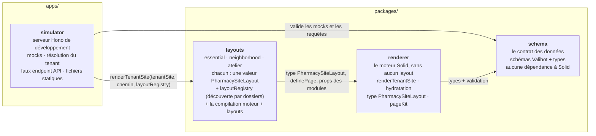
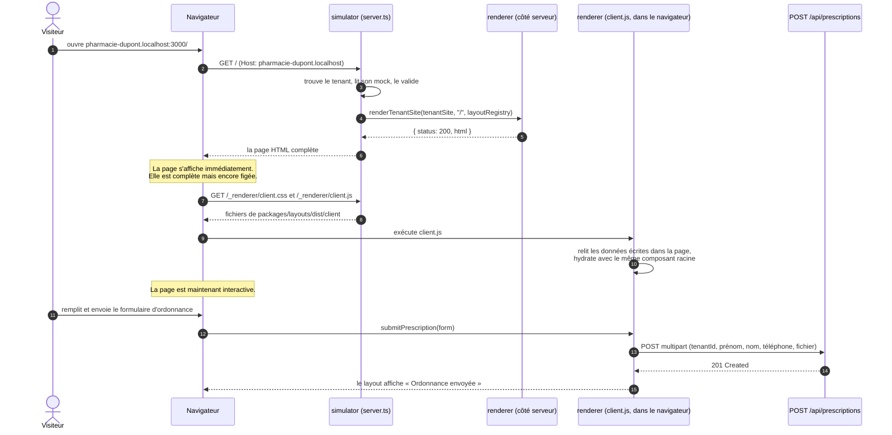
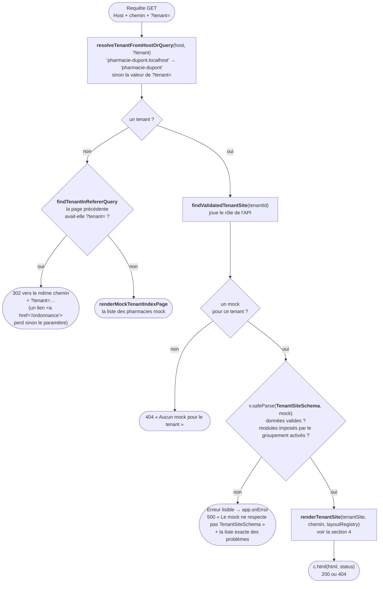
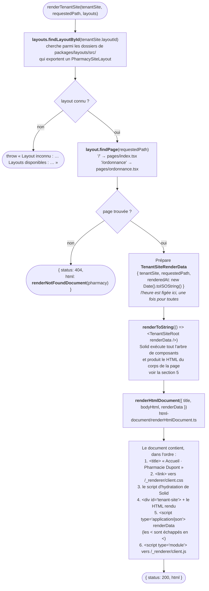
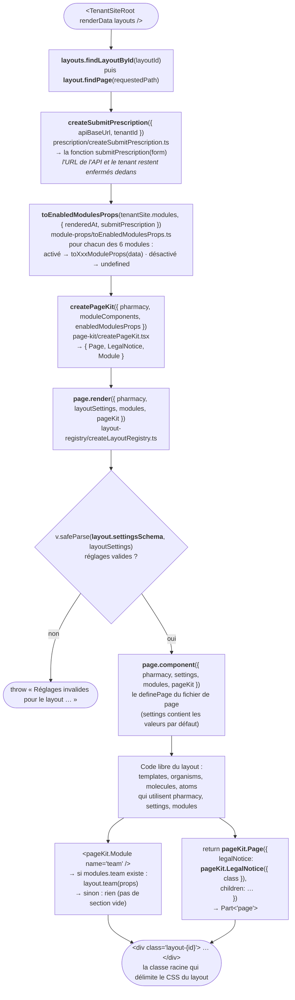
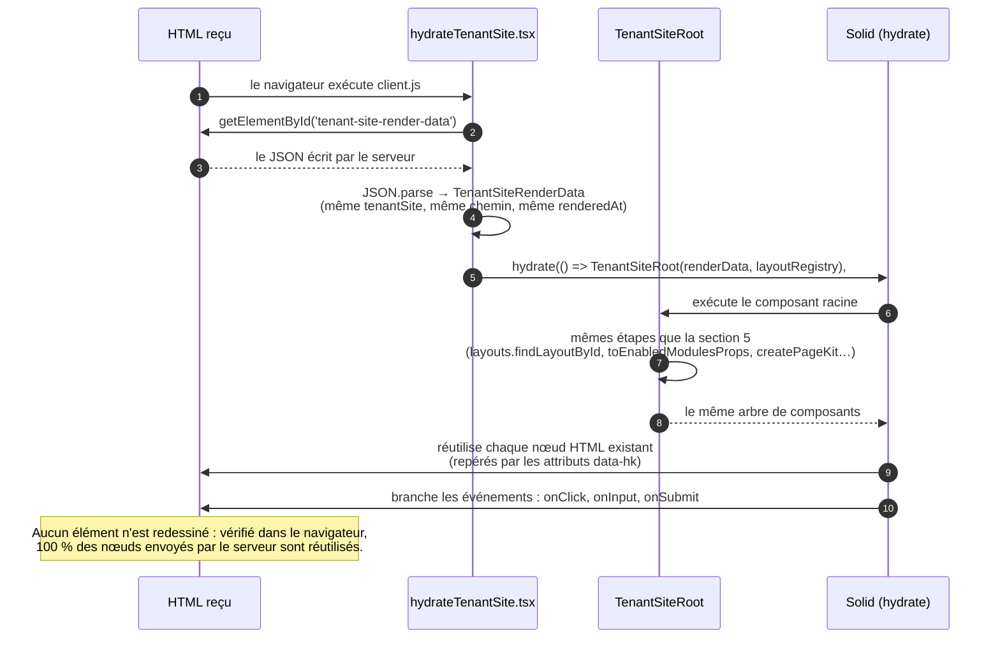
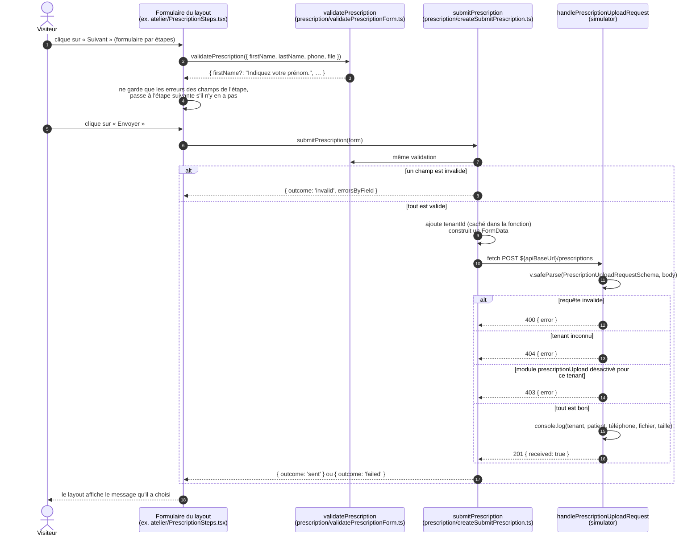
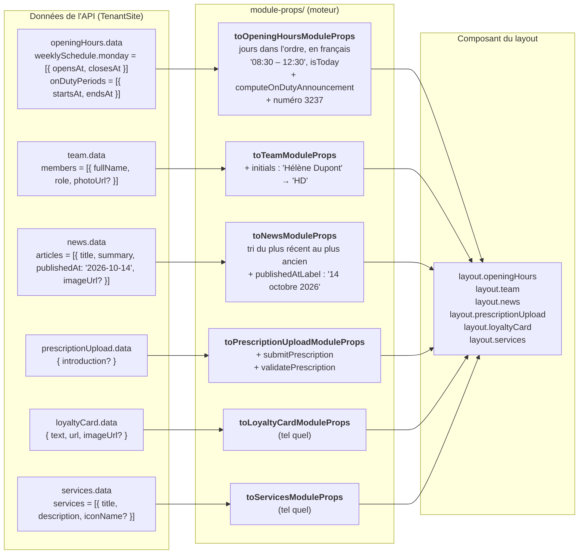

# Fonctionnement complet

Ce document suit une visite sur le site d'une pharmacie, de la première requête jusqu'à l'envoi d'une
ordonnance. Chaque nom en `code` est un vrai fichier ou une vraie fonction du projet : on peut le
retrouver avec Ctrl+P dans l'éditeur.

1. [Les quatre paquets et qui dépend de qui](#1-les-quatre-paquets-et-qui-dépend-de-qui)
2. [Vue d'ensemble d'une visite](#2-vue-densemble-dune-visite)
3. [Côté serveur : de la requête au HTML](#3-côté-serveur--de-la-requête-au-html)
4. [L'algorithme de `renderTenantSite`, pas à pas](#4-lalgorithme-de-rendertenantsite-pas-à-pas)
5. [Ce qui se passe à l'intérieur de `TenantSiteRoot`](#5-ce-qui-se-passe-à-lintérieur-de-tenantsiteroot)
6. [Côté navigateur : l'hydratation](#6-côté-navigateur--lhydratation)
7. [L'envoi d'une ordonnance](#7-lenvoi-dune-ordonnance)
8. [Comment les données se transforment](#8-comment-les-données-se-transforment)
9. [Ce que le typage garantit, et où](#9-ce-que-le-typage-garantit-et-où)

---

## 1. Les quatre paquets et qui dépend de qui

La règle la plus importante du projet : les flèches ne vont que dans un sens. Le schéma ne connaît
personne, le moteur ne connaît que le schéma, les layouts ne connaissent que le moteur, et le
simulateur (le futur serveur des sites) assemble le tout.

| Paquet | Il sait | Il ne sait pas |
|---|---|---|
| `schema` | À quoi ressemblent les données d'un site et d'une ordonnance | Qu'il existe Solid, un serveur, des layouts |
| `renderer` | Rendre n'importe quel `PharmacySiteLayout` avec des données validées, puis rendre la page interactive | Quels layouts existent, d'où viennent les données, quel est le tenant |
| `layouts` | Dessiner les sites, chacun à sa façon | D'où viennent les données, comment une page est envoyée au navigateur |
| `simulator` | Trouver le tenant à partir de l'URL, lire les mocks, servir les fichiers | Comment une page est dessinée |

---

## 2. Vue d'ensemble d'une visite

Une visite se passe en trois temps : le serveur envoie une page déjà complète, le navigateur la
rend interactive, puis le visiteur peut envoyer son ordonnance.

---

## 3. Côté serveur : de la requête au HTML

Tout part de `app.get('*')` dans `apps/simulator/src/server.ts`. Le simulateur décide quel tenant
est demandé, puis délègue tout le rendu au moteur.

Les fichiers statiques sont servis avant cette route :

| URL | Dossier servi | Contenu |
|---|---|---|
| `/_renderer/*` | `packages/layouts/dist/client` | `client.js`, `client.css`, polices |
| `/mock-images/*` | `apps/simulator/public/mock-images` | Photos et logos des mocks |
| `POST /api/prescriptions` | `handlePrescriptionUploadRequest` | Le faux endpoint, voir la section 7 |

---

## 4. L'algorithme de `renderTenantSite`, pas à pas

Le moteur reçoit les layouts en paramètre (`layoutRegistry`). Ils sont trouvés **par les dossiers** de
`packages/layouts/src/` : le dossier `atelier/`, dont `atelier.ts` exporte un `PharmacySiteLayout`, est
le layout `atelier`, et le fichier `atelier/pages/ordonnance.tsx` est sa page `/ordonnance`. Aucune
liste n'est déclarée à la main.

`packages/renderer/src/renderTenantSite.tsx` est le point d'entrée du moteur côté serveur. Il reçoit
un `TenantSite` **déjà validé** et un chemin, et renvoie `{ status, html }`.

> **Pourquoi l'heure est-elle figée dans `renderData` ?** Les horaires (« Aujourd'hui ») et la garde
> (« En garde actuellement ») dépendent de l'heure. Si le serveur et le navigateur lisaient chacun leur
> horloge, ils pourraient produire un HTML différent et l'hydratation casserait. Le serveur fixe donc
> l'heure une fois, et le navigateur réutilise exactement la même.

---

## 5. Ce qui se passe à l'intérieur de `TenantSiteRoot`

`packages/renderer/src/TenantSiteRoot.tsx` est **le même composant** sur le serveur et dans le
navigateur. C'est lui qui prépare tout ce que le layout va recevoir.

Le layout **ne reçoit jamais** le `TenantSite` entier. Il ne reçoit que :

| Prop | Contenu | D'où ça vient |
|---|---|---|
| `pharmacy` | Nom, adresse, téléphone, logo, groupement… | `tenantSite.pharmacy`, tel quel |
| `settings` | Les réglages du layout, avec leurs valeurs par défaut | `tenantSite.layoutSettings` validé par `layout.settingsSchema` |
| `modules` | Les props de chaque module activé, `undefined` sinon | `toEnabledModulesProps` |
| `pageKit` | `Page`, `LegalNotice`, `Module` | `createPageKit` |

---

## 6. Côté navigateur : l'hydratation

`packages/layouts/src/browserEntry.tsx` est compilé dans `client.js` : il appelle
`hydrateTenantSite(layoutRegistry)` (`packages/renderer/src/hydrateTenantSite.tsx`). Il refait exactement le
même calcul que le serveur, avec les mêmes données, mais au lieu de produire du HTML, Solid **se
rattache** au HTML déjà affiché.

Pour que ça marche, il faut que le serveur et le navigateur produisent **exactement** le même arbre.
D'où ces règles, appliquées partout :

| Règle | Pourquoi |
|---|---|
| L'heure vient de `renderedAt`, jamais de `new Date()` dans un composant | Même texte sur le serveur et dans le navigateur |
| Les dates sont formatées par `formatInParisTimeZone` | Même résultat quel que soit le fuseau de la machine |
| On ne déstructure pas les props Solid (`props.x`, pas `const { x } = props`) | Solid suit les changements à travers `props` |
| `<Show>` et `<For>` pour les conditions et les listes | Solid sait les hydrater et les mettre à jour |

---

## 7. L'envoi d'une ordonnance

Le formulaire est écrit **librement** par chaque layout : ses champs, son état, ses étapes, ses
messages. Le moteur ne lui donne que deux fonctions typées, dans les props du module
`prescriptionUpload`.

Pourquoi ce découpage :

- **Le layout ne peut pas oublier un champ.** `submitPrescription` exige un objet avec `firstName`,
  `lastName`, `phone` et `file` : un champ manquant ne compile pas.
- **Le layout ne peut pas appeler l'API lui-même.** Il ne connaît ni son URL ni le tenant : ils sont
  enfermés dans `createSubmitPrescription`.
- **Les règles de validation sont écrites une seule fois.** `PrescriptionUploadRequestSchema` (dans
  `schema`) sert au navigateur et au serveur.

---

## 8. Comment les données se transforment

Les données de l'API ne vont pas telles quelles dans les composants. Elles passent par des fonctions
`toXxxModuleProps`, qui préparent ce qui est pénible ou risqué à faire dans un layout.

Exemple concret de la garde, calculée par `computeOnDutyAnnouncement` à partir de `renderedAt` :

| Situation | Message reçu par le layout |
|---|---|
| L'heure du rendu est dans une période de garde | `{ status: 'onDutyNow', message: "En garde actuellement, jusqu'à jeudi 08:00" }` |
| Une garde commence plus tard dans la journée | `{ status: 'onDutyLaterToday', message: 'En garde ce soir, à partir de 19:00' }` |
| Aucune garde aujourd'hui | `undefined` : le layout n'affiche rien |
| Dans tous les cas | `onDutyHotline` : « En dehors de nos horaires, composez le 3237… » |

---

## 9. Ce que le typage garantit, et où

| Garantie | Mécanisme | Fichier |
|---|---|---|
| Un layout qui oublie un module ne compile pas | `PharmacySiteLayout` exige une clé par `ModuleName` | `contract/PharmacySiteLayout.ts` |
| Un composant de module qui attend une prop inexistante ne compile pas | `Component<ModulePropsByName[Name]>`, déclaré comme propriété | `contract/PharmacySiteLayout.ts` |
| Le schéma de réglages produit bien le type utilisé par les pages | `PharmacySiteLayout<Réglages>` exige `settingsSchema: GenericSchema<unknown, Réglages>` | `contract/PharmacySiteLayout.ts` |
| Une page sans titre ne compile pas, et ses réglages sont typés | `definePage<Réglages>({ title, component })` | `contract/definePage.ts` |
| Un fichier de page mal exporté, ou des pages sans layout, sont signalés au démarrage | Vérification de chaque fichier trouvé | `layout-registry/createLayoutRegistry.ts` |
| Une page sans mentions légales ne compile pas | `Part<'page'>` n'est fabriqué que par `pageKit.Page`, qui exige un `Part<'legalNotice'>` | `contract/Part.ts`, `page-kit/createPageKit.tsx` |
| Un JSX écrit à la main n'est pas une page | `Part` est un type marqué ; `createPart` n'est pas exporté | `page-kit/createPageKit.tsx` |
| Une donnée optionnelle (photo, groupement…) est traitée comme optionnelle | `photoUrl?: string` : l'utiliser comme `string` ne compile pas | `schema` |
| Un formulaire d'ordonnance n'oublie aucun champ | `PrescriptionForm` exige les 4 champs | `prescription/validatePrescriptionForm.ts` |
| Un module imposé par le groupement ne peut pas être désactivé | `v.rawCheck` dans le schéma : vérifié à chaque validation | `schema/src/TenantSiteSchema.ts` |
| Un nouveau module doit être géré partout | `satisfies Record<ModuleName, …>` dans le schéma, puis `LayoutModuleComponents` | `schema/src/modules/TenantModulesSchema.ts` |
