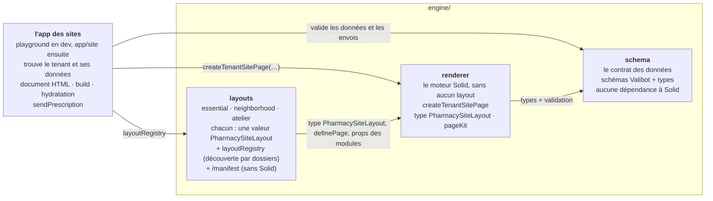
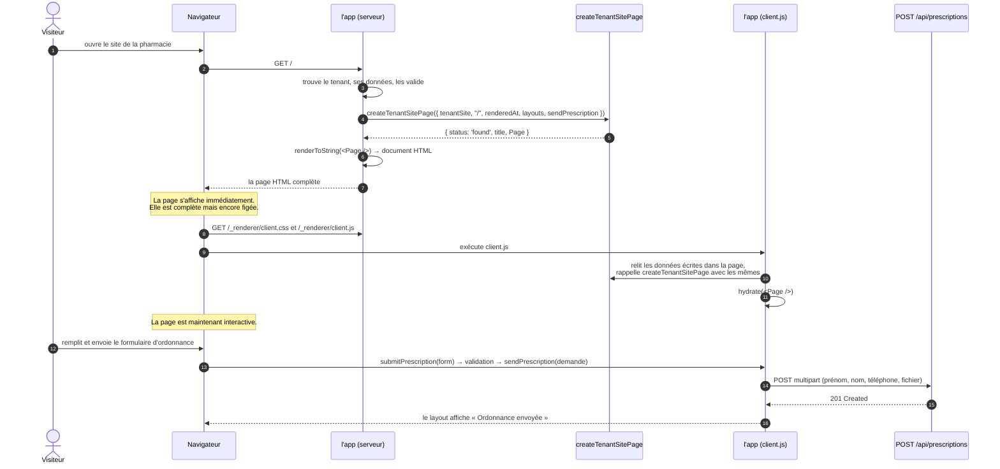
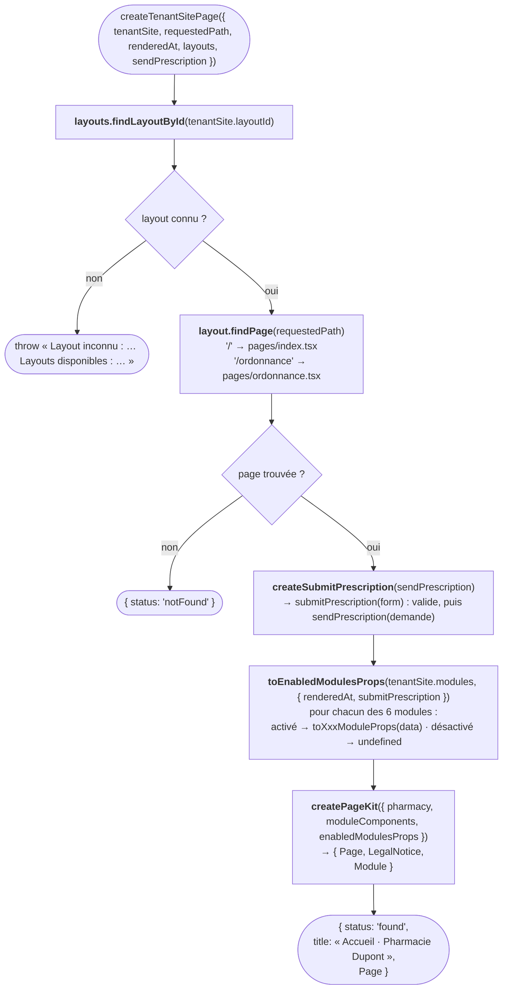
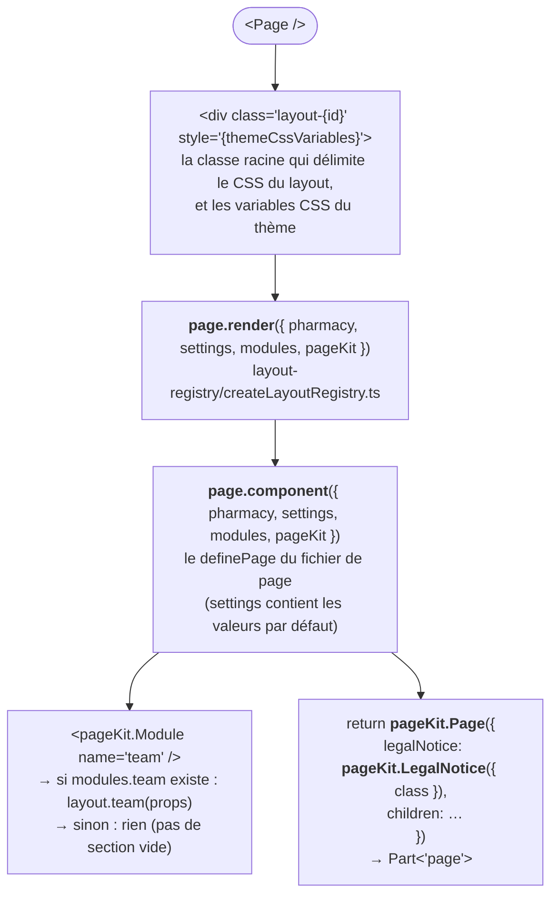
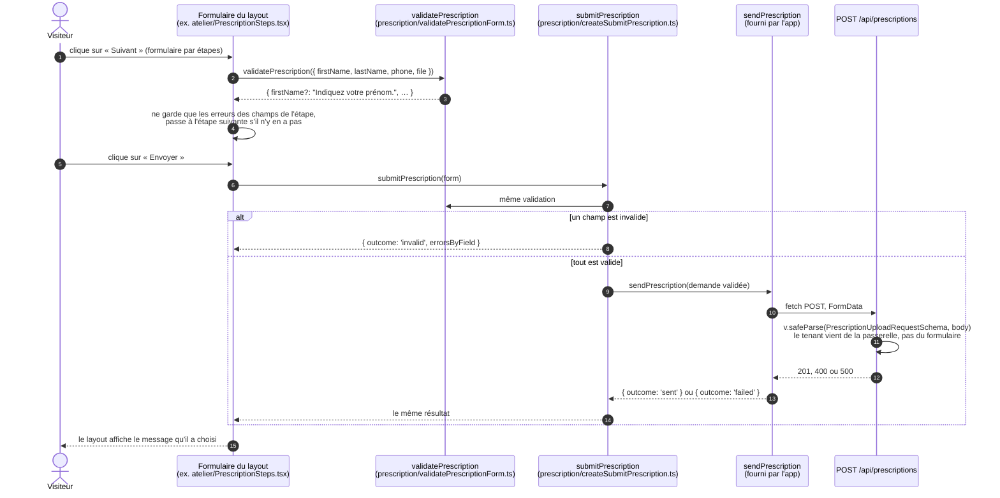
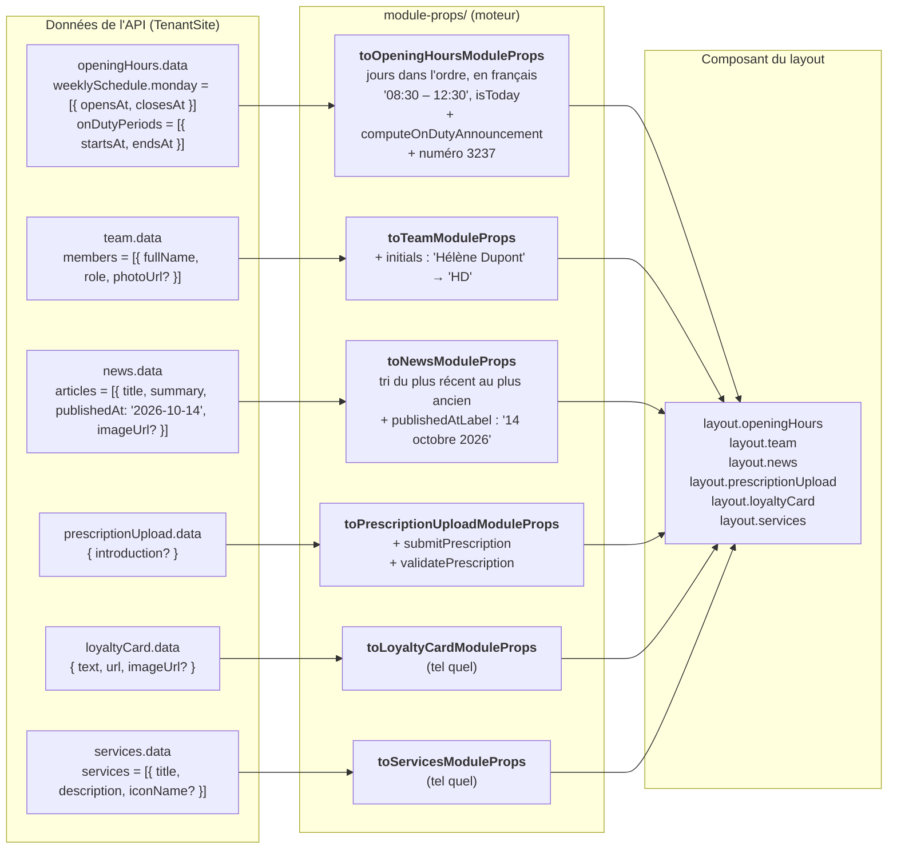

# Fonctionnement complet

Ce document suit une visite sur le site d'une pharmacie, de la première requête jusqu'à l'envoi d'une
ordonnance. Chaque nom en `code` est un vrai fichier ou une vraie fonction du projet : on peut le
retrouver avec Ctrl+P dans l'éditeur.

L'app qui sert les sites est ici le banc d'essai (`engine/playground`) ; `app/site` fera la même chose
avec SolidStart, ses bases de données et la passerelle.

1. [Les paquets et qui dépend de qui](#1-les-paquets-et-qui-dépend-de-qui)
2. [Vue d'ensemble d'une visite](#2-vue-densemble-dune-visite)
3. [Côté serveur : de la requête au HTML](#3-côté-serveur--de-la-requête-au-html)
4. [L'algorithme de `createTenantSitePage`, pas à pas](#4-lalgorithme-de-createtenantsitepage-pas-à-pas)
5. [Ce que reçoit le layout](#5-ce-que-reçoit-le-layout)
6. [Côté navigateur : l'hydratation](#6-côté-navigateur--lhydratation)
7. [L'envoi d'une ordonnance](#7-lenvoi-dune-ordonnance)
8. [Comment les données se transforment](#8-comment-les-données-se-transforment)
9. [Ce que le typage garantit, et où](#9-ce-que-le-typage-garantit-et-où)

---

## 1. Les paquets et qui dépend de qui

La règle la plus importante du moteur : les flèches ne vont que dans un sens. Le schéma ne connaît
personne, le moteur ne connaît que le schéma, les layouts ne connaissent que le moteur, et l'app qui
sert les sites assemble le tout.



| Paquet | Il sait | Il ne sait pas |
|---|---|---|
| `schema` | À quoi ressemblent les données d'un site et d'une ordonnance | Qu'il existe Solid, un serveur, des layouts |
| `renderer` | Fabriquer la page de n'importe quel `PharmacySiteLayout` à partir de données validées | Quels layouts existent, d'où viennent les données, quel est le tenant, où part l'ordonnance |
| `layouts` | Dessiner les sites, chacun à sa façon | D'où viennent les données, comment une page est envoyée au navigateur |
| l'app | Trouver le tenant et ses données, rendre le HTML, servir le JS et le CSS, envoyer l'ordonnance | Comment une page est dessinée |

---

## 2. Vue d'ensemble d'une visite

Une visite se passe en trois temps : le serveur envoie une page déjà complète, le navigateur la
rend interactive, puis le visiteur peut envoyer son ordonnance.



---

## 3. Côté serveur : de la requête au HTML

Dans le banc d'essai, tout part de `handleSiteRequest` (`playground/src/server/site-requests/`) :

| URL | Réponse |
|---|---|
| `/_renderer/*` | `dist/site/client` : `client.js`, `client.css`, polices (`serveSiteAsset`) |
| `/mock-images/*` | Les images dessinées des mocks (`serveMockImage`) |
| `POST /api/prescriptions` | La fausse API, voir la section 7 |
| tout le reste | La page : `renderScenarioPage` |

`renderScenarioPage` assemble le `TenantSite` du scénario en cours, le valide avec `TenantSiteSchema`
(données invalides : une page d'erreur qui liste les problèmes), puis appelle
`renderTenantSiteDocument`, compilé dans `dist/site/server/serverEntry.js` :

```mermaid
flowchart TD
    start(["renderTenantSiteDocument(tenantSite, requestedPath)<br/>playground/src/site/serverEntry.tsx"]) --> renderData["Prépare <b>TenantSiteRenderData</b><br/>{ tenantSite, requestedPath,<br/>renderedAt: new Date().toISOString() }<br/><i>l'heure est figée ici, une fois pour toutes</i>"]
    renderData --> create["<b>createSitePage</b>(renderData, sendPrescription)<br/>→ createTenantSitePage, voir la section 4"]
    create --> found{"status ?"}
    found -- notFound --> notFound(["{ status: 404,<br/>html: <b>renderNotFoundDocument</b>(pharmacy) }"])
    found -- found --> toString["<b>renderToString</b>(() => &lt;Page /&gt;)<br/>le HTML du corps de la page"]
    toString --> document["<b>renderHtmlDocument</b>({ title, bodyHtml, renderData })<br/>1. &lt;title&gt; « Accueil · Pharmacie Dupont »<br/>2. &lt;link&gt; vers /_renderer/client.css<br/>3. le script d'hydratation de Solid<br/>4. &lt;div id='tenant-site'&gt; + le HTML rendu<br/>5. &lt;script type='application/json'&gt; renderData<br/>   (les &lt; sont échappés)<br/>6. &lt;script type='module'&gt; vers /_renderer/client.js"]
    document --> done(["{ status: 200, html }"])
```

> **Pourquoi l'heure est-elle figée dans `renderData` ?** Les horaires (« Aujourd'hui ») et la garde
> (« En garde actuellement ») dépendent de l'heure. Si le serveur et le navigateur lisaient chacun leur
> horloge, ils pourraient produire un HTML différent et l'hydratation casserait. Le serveur fixe donc
> l'heure une fois, et le navigateur réutilise exactement la même.

---

## 4. L'algorithme de `createTenantSitePage`, pas à pas

Le moteur reçoit les layouts en paramètre (`layoutRegistry`). Ils sont trouvés **par les dossiers** de
`engine/layouts/src/` : le dossier `atelier/`, dont `atelier.ts` exporte un `PharmacySiteLayout`, est
le layout `atelier`, et le fichier `atelier/pages/ordonnance.tsx` est sa page `/ordonnance`. Aucune
liste n'est déclarée à la main.

`engine/renderer/src/createTenantSitePage.tsx` est le même appel sur le serveur et dans le navigateur.



Avant, `createTenantSitePage` appelle `layout.readSettings(layoutSettings)` : `v.safeParse(layout.settingsSchema, …)`
(sinon `throw « Réglages invalides pour le layout … »`), puis `toThemeCssVariables` lit les réglages du thème.

Quand l'app rend `<Page />` :



---

## 5. Ce que reçoit le layout

Le layout **ne reçoit jamais** le `TenantSite` entier. Il ne reçoit que :

| Prop | Contenu | D'où ça vient |
|---|---|---|
| `pharmacy` | Nom, adresse, téléphone, logo, groupement… | `tenantSite.pharmacy`, tel quel |
| `settings` | Les réglages du layout, avec leurs valeurs par défaut | `tenantSite.layoutSettings` validé par `layout.settingsSchema` |
| `modules` | Les props de chaque module activé, `undefined` sinon | `toEnabledModulesProps` |
| `pageKit` | `Page`, `LegalNotice`, `Module` | `createPageKit` |

---

## 6. Côté navigateur : l'hydratation

`playground/src/site/browserEntry.tsx` est compilé dans `client.js`. Il refait exactement le même
appel que le serveur, avec les mêmes données, mais au lieu de produire du HTML, Solid **se rattache**
au HTML déjà affiché.

```mermaid
sequenceDiagram
    autonumber
    participant Page as HTML reçu
    participant Entry as browserEntry.tsx
    participant Engine as createTenantSitePage
    participant Solid as Solid (hydrate)

    Page->>Entry: le navigateur exécute client.js
    Entry->>Page: getElementById('tenant-site-render-data')
    Page-->>Entry: le JSON écrit par le serveur
    Entry->>Engine: createSitePage(renderData, sendPrescription du navigateur)<br/>(même tenantSite, même chemin, même renderedAt)
    Engine-->>Entry: { status: 'found', Page }
    Entry->>Solid: hydrate(() => &lt;Page /&gt;, #tenant-site)
    Solid->>Page: réutilise chaque nœud HTML existant<br/>(repérés par les attributs data-hk)
    Solid->>Page: branche les événements : onClick, onInput, onSubmit
    Note over Page: Aucun élément n'est redessiné : le panneau du banc d'essai<br/>affiche la part des nœuds du serveur réutilisés.
```

Pour que ça marche, il faut que le serveur et le navigateur produisent **exactement** le même arbre.
D'où ces règles, appliquées partout :

| Règle | Pourquoi |
|---|---|
| L'heure vient de `renderedAt`, jamais de `new Date()` dans un composant | Même texte sur le serveur et dans le navigateur |
| Les dates sont formatées par `formatInParisTimeZone` | Même résultat quel que soit le fuseau de la machine |
| On ne déstructure pas les props Solid (`props.x`, pas `const { x } = props`) | Solid suit les changements à travers `props` |
| `<Show>` et `<For>` pour les conditions et les listes | Solid sait les hydrater et les mettre à jour |

---

## 7. L'envoi d'une ordonnance

Le formulaire est écrit **librement** par chaque layout : ses champs, son état, ses étapes, ses
messages. Le moteur ne lui donne que deux fonctions typées, dans les props du module
`prescriptionUpload`. L'envoi lui-même appartient à l'app.



Pourquoi ce découpage :

- **Le layout ne peut pas oublier un champ.** `submitPrescription` exige un objet avec `firstName`,
  `lastName`, `phone` et `file` : un champ manquant ne compile pas.
- **Le layout ne peut pas appeler l'API lui-même.** Il ne connaît ni son URL ni le tenant.
- **Rien ne part sans être validé.** `sendPrescription` ne reçoit qu'une demande déjà passée par
  `PrescriptionUploadRequestSchema`.
- **Le moteur reste pur.** Où et comment envoyer, et pour quel tenant, c'est l'app qui le sait.
- **Les règles de validation sont écrites une seule fois.** `PrescriptionUploadRequestSchema` (dans
  `schema`) sert au navigateur et au serveur.

---

## 8. Comment les données se transforment

Les données de l'API ne vont pas telles quelles dans les composants. Elles passent par des fonctions
`toXxxModuleProps`, qui préparent ce qui est pénible ou risqué à faire dans un layout.



Exemple concret de la garde, calculée par `computeOnDutyAnnouncement` à partir de `renderedAt` :

| Situation | Message reçu par le layout |
|---|---|
| L'heure du rendu est dans une période de garde | `{ status: 'onDutyNow', message: "En garde actuellement, jusqu'à jeudi 08:00" }` |
| Une garde commence plus tard dans la journée | `{ status: 'onDutyLaterToday', message: 'En garde ce soir, à partir de 19:00' }` |
| Aucune garde aujourd'hui | `undefined` : le layout n'affiche rien |
| Dans tous les cas | `onDutyHotline` : « En dehors de nos horaires, composez le 3237… » |

---

## 9. Ce que le typage garantit, et où

| Garantie | Mécanisme | Fichier |
|---|---|---|
| Un layout qui oublie un module ne compile pas | `PharmacySiteLayout` exige une clé par `ModuleName` | `contract/PharmacySiteLayout.ts` |
| Un composant de module qui attend une prop inexistante ne compile pas | `Component<ModulePropsByName[Name]>`, déclaré comme propriété | `contract/PharmacySiteLayout.ts` |
| Le schéma de réglages produit bien le type utilisé par les pages | `PharmacySiteLayout<Réglages>` exige `settingsSchema: ObjectSchema & GenericSchema<unknown, Réglages>` | `contract/PharmacySiteLayout.ts` |
| Une page sans titre ne compile pas, et ses réglages sont typés | `definePage<Réglages>({ title, component })` | `contract/definePage.ts` |
| Un fichier de page mal exporté, des pages sans layout, ou un layout sans manifeste, sont signalés au démarrage | Vérification de chaque fichier trouvé | `layout-registry/createLayoutRegistry.ts`, `layouts/src/layoutRegistry.ts` |
| Une page sans mentions légales ne compile pas | `Part<'page'>` n'est fabriqué que par `pageKit.Page`, qui exige un `Part<'legalNotice'>` | `contract/Part.ts`, `page-kit/createPageKit.tsx` |
| Un JSX écrit à la main n'est pas une page | `Part` est un type marqué ; `createPart` n'est pas exporté | `page-kit/createPageKit.tsx` |
| Une donnée optionnelle (photo, groupement…) est traitée comme optionnelle | `photoUrl?: string` : l'utiliser comme `string` ne compile pas | `schema` |
| Un formulaire d'ordonnance n'oublie aucun champ | `PrescriptionForm` exige les 4 champs | `prescription/validatePrescriptionForm.ts` |
| Un module imposé par le groupement ne peut pas être désactivé | `v.rawCheck` dans le schéma : vérifié à chaque validation | `schema/src/TenantSiteSchema.ts` |
| Un nouveau module doit être géré partout | `satisfies Record<ModuleName, …>` dans le schéma, puis `LayoutModuleComponents` | `schema/src/modules/TenantModulesSchema.ts` |
